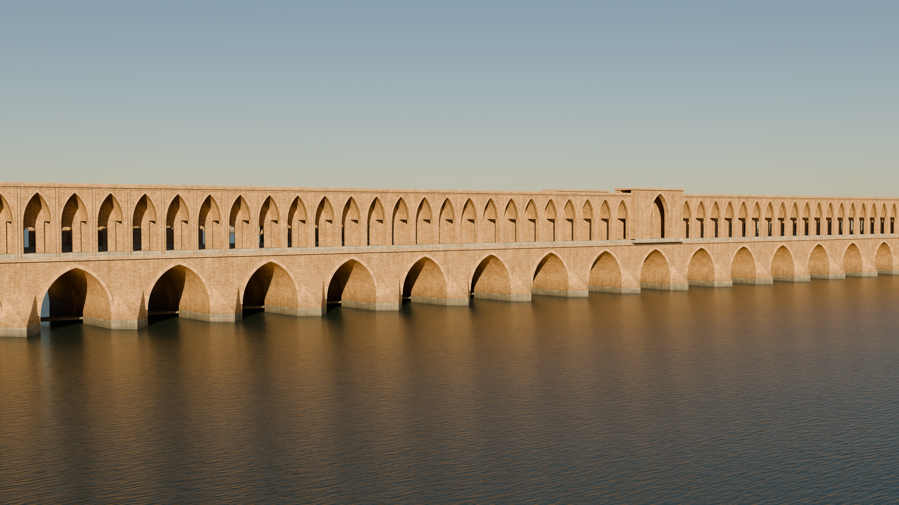
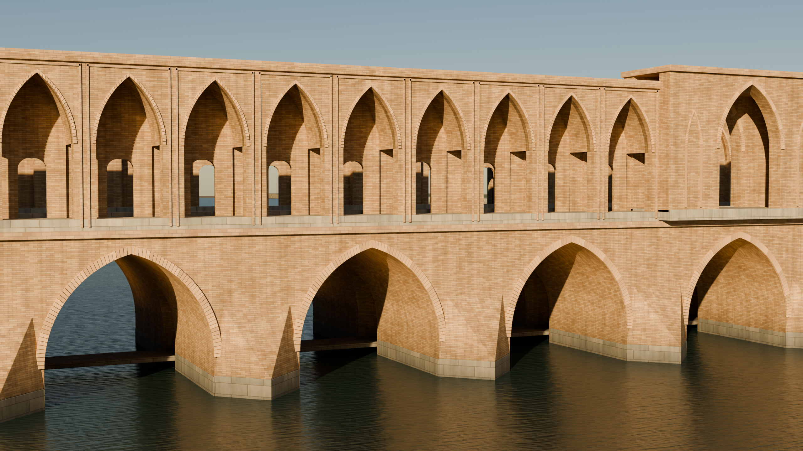
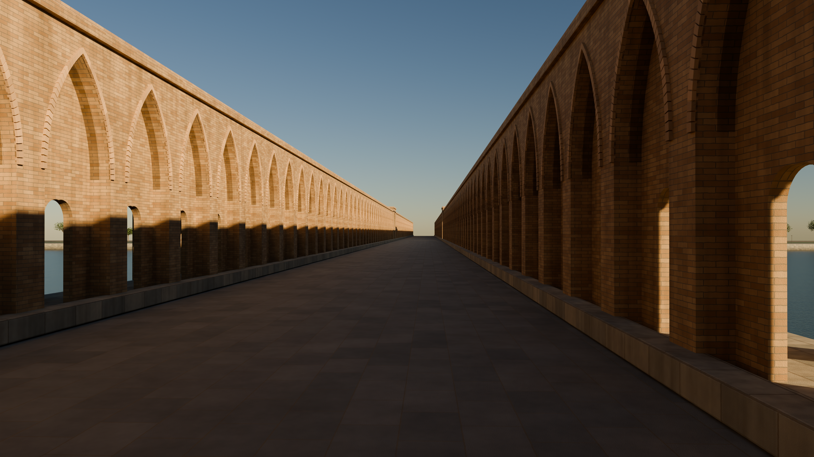

# Si-o-se-pol · Isfahan

An editable Blender reconstruction of the Bridge of Thirty-three Arches, with present-day architectural character and a flowing Zayandeh Rud. Built in metres, with real arch openings, modeled radial brickwork, procedural materials, and six inspection cameras.



**Open the model:** [`output/si_o_se_pol.blend`](output/si_o_se_pol.blend). All geometry and shaders are contained in this file; no texture downloads or paid add-ons are needed. Use **Blender 4.5 LTS or newer**. The native Blender file is the primary deliverable.

This is a detailed **visual reconstruction**, not a laser-scanned, survey-certified, structurally analyzed, or live-instrumented digital twin. Overall dimensions are drawn from published references; unsurveyed architectural details and the surrounding landscape are reconstructed. See [accuracy and provenance](docs/accuracy.md).

## Included

- 33 numbered, open pointed river vaults; pierced masonry piers and a lower longitudinal gallery.
- Dense upper arcades on both sides, recessed niches with smaller access portals, curved gallery ceilings, and central projecting pavilions.
- Individually modeled radial arch bricks, stone foundations, triangular cutwaters, coping, string courses, seating ledges, and a broad open pedestrian deck.
- Metre-scaled brick and stone shaders with mortar relief, grain, color variation, and damp staining near the waterline.
- Flowing river with animated ripple shading, reflective water, riverbanks, approach ramps, and procedural trees.
- Six named cameras: river panorama, complete elevation, masonry detail, upper promenade, lower gallery, and aerial overview.
- Deterministic source generator, editable [dimensions](config/bridge.json), geometry tests, and a [build validation report](output/validation.json).

## Views

| River masonry | Upper promenade |
| --- | --- |
|  |  |

Additional rendered views are in [`renders/`](renders/). The delivered river image is 3840 × 2160 with up to 128 Cycles samples; the five inspection views are 2560 × 1440 with up to 64 samples. Denoising is enabled. Exact settings are recorded in [`output/renders.json`](output/renders.json). The presets below allow higher sample counts when rerendering.

The [dimensioned model sheet](docs/model_sheet.svg) shows the complete river elevation, deck plan, and a typical river bay. It is a schematic of the generated model, with estimated dimensions labeled; it is not a survey drawing.

## Fly-through video

[Watch the one-minute fly-through](video/si_o_se_pol_flythrough_60s.mp4): a slower 60-second, 1080p/24 fps cut of the five original viewpoints. It uses motion-compensated interpolation of the untitled render frames, processed separately per shot to preserve clean cuts. Titles and chapters follow the longer timing. The original Blender camera animation remains 24 seconds.

Rebuild the extended cut with `python3 manage.py extend-video` after rendering the original PNG frames. FFmpeg and ffprobe are required. Intermediate lossless segments are cached in `video/extended-cache/` and excluded from Git. Timing and provenance are recorded in `video/manifest_60s.json`; the final MP4 is checked for exact frame count, duration, dimensions, and decoding errors.

[Watch the 24-second fly-through](video/si_o_se_pol_flythrough.mp4): a 1920 × 1080, 24 fps H.264 video with a riverfront approach, a flight through a river arch, upper promenade and lower-gallery passages, and a full-bridge aerial pullback. The video is silent, with location titles and embedded chapters.

The camera paths are animated in 3D and checked against the bridge meshes at every frame. The separate [`output/si_o_se_pol_flythrough.blend`](output/si_o_se_pol_flythrough.blend) contains the editable camera animation. The video uses EEVEE with daytime lighting and reflective water adapted for animation; the original Cycles scene remains available for still rendering.

```sh
python3 manage.py video
python3 manage.py encode-video
python3 manage.py open-video
```

Rendering requires Blender; encoding requires FFmpeg and ffprobe on PATH. The default animation uses 16 EEVEE samples with motion blur at 1080p. Use `--width` and `--samples` with `video` to change these settings. Camera waypoints and timing are in `scripts/flythrough_path.py`.

Individual PNG frames are cached in `video/frames/` and excluded from Git. An interrupted render resumes completed frames when settings and source match; move or remove that cache before changing the choreography, model, or quality. For an unchanged prepared animation, the Blender script also accepts `--prepared` when opening the fly-through `.blend`. The MP4 encoder verifies every frame, adds titles and chapters, and checks the final codec, frame count, dimensions, and duration. Settings and camera-clearance checks are recorded in [`video/manifest.json`](video/manifest.json).

## Use

Install [Blender](https://www.blender.org/download/), then run these commands from the repository. The launcher detects Blender on PATH, macOS Applications, the usual Windows 4.5 path, or the `BLENDER` environment variable.

```sh
python3 manage.py open
python3 manage.py build --quality standard
python3 manage.py render --views hero,detail,deck --quality standard
python3 manage.py render --views all --quality final
python3 manage.py test
python3 manage.py verify
python3 manage.py sheet
```

`build` regenerates `output/si_o_se_pol.blend` from the source and configuration, replacing that generated file. Save hand-edited variations under a different filename. `render` uses the existing saved scene and leaves it unchanged. Preview is 1440 px / 32 samples; standard is 2560 px / 96 samples; final is 3840 px / 256 samples. The saved scene defaults to CPU for portability. The command-line renderer uses Metal when available, otherwise CPU; `--threads` controls CPU threads. You can also configure your GPU in Blender's Cycles preferences.

In Blender, press **Numpad 0** to enter the camera, **Home** to frame the scene, or select an object and use **Numpad .** to inspect it. The Outliner separates structure, detail, landscape, cameras, and lighting. Hide `12 | Riverside trees` and `10 | River` for lighter architectural inspection. Choose a different scene camera in Scene Properties. Use Material Preview or Rendered shading to see the procedural materials.

Water shading animates over frames 1–240 at 24 fps; playback does not simulate hydraulic flow or animate mesh-level river motion. `scripts/render_scene.py --frame` can render a chosen time. The surface is intentionally calm enough to retain the bridge reflections.

## Repository

| Path | Purpose |
| --- | --- |
| `config/bridge.json` | Dimensions, water level, deterministic random seed |
| `scripts/geometry.py` | Independent arch profiles and mesh construction |
| `scripts/build_scene.py` | Blender geometry, materials, context, lighting, cameras |
| `scripts/render_scene.py` | Render existing scene without rebuilding |
| `scripts/draw_sheet.py` | Regenerate the dimensioned SVG model sheet |
| `scripts/verify_scene.py` | Reopen and check the actual Blender artifact |
| `manage.py` | Cross-platform command launcher |
| `tests/` | Arch geometry, span layout, and closed-component checks |
| `output/` | Native Blender scene and validation manifest |
| `renders/` | Actual Cycles renders from the delivered scene |
| `docs/accuracy.md` | Sources, assumptions, and limitations |

Reference photographs informed the architectural interpretation. The scene's geometry and materials are generated natively in Blender; reference photographs are excluded from distribution.
